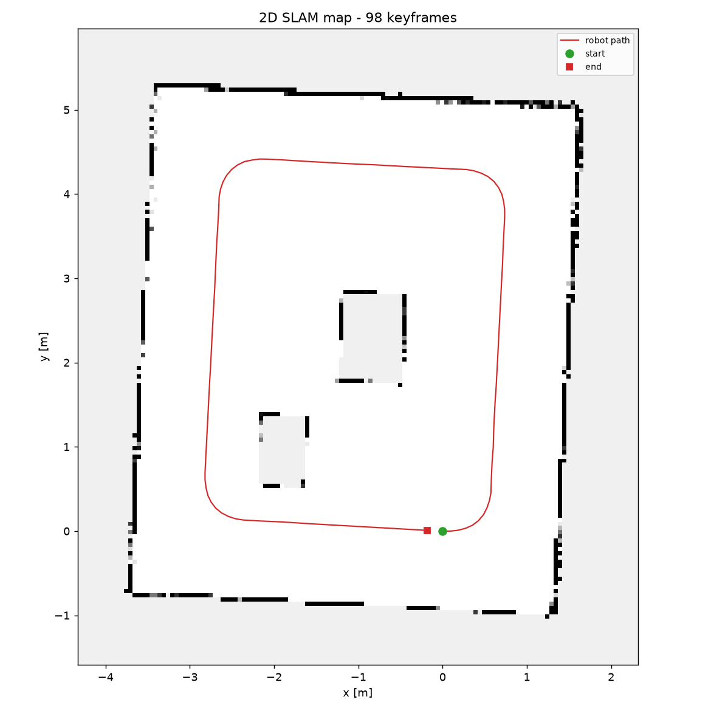

# Running this project in VS Code (lidar on COM8, no ESP32)

This is the shortest working path: RPLIDAR's own USB adapter in the laptop, VS
Code opens the `room_slam` folder, and four clicks get you a map.

Assumes **Windows** (for `COM8`); the Linux/macOS differences are called out at
the points where they matter.

---

## 0. What you need

| Item | Note |
| --- | --- |
| RPLIDAR A1 + its USB adapter board | the little board the lidar cable plugs into |
| USB cable | **data** cable, not charge-only |
| CP210x or CH340 USB-serial driver | see step 2 — Windows usually installs this itself |
| Python 3.9 – 3.12 | 3.13 may not have wheels for every dependency yet |
| VS Code | plus the Microsoft **Python** extension |

You do **not** need the ESP32, WiFi, or an Arduino for this path.

---

## 1. Open the folder in VS Code

1. `File → Open Folder…`
2. Select the **`room_slam`** folder itself (the one containing `slam2d/`,
   `docs/`, `Makefile`) — **not** the `g2o` folder above it.

Why: the commands below are `python -m slam2d.…`, and that only resolves when
`room_slam` is the working directory. Opening the parent folder works too, but
you would have to `cd room_slam` in every terminal.

The folder already ships a `.vscode/` directory with six ready-made run
configurations, so most of step 5 is already done for you.

---

## 2. Plug in the lidar and find the port

1. Plug the lidar's USB adapter into the laptop.
2. Windows: `Win+X → Device Manager → Ports (COM & LPT)`. You should see
   **Silicon Labs CP210x USB to UART Bridge (COM8)** — the number is what you use.
3. Confirm from the terminal:

```bash
python -m slam2d.record_lidar_usb --list-ports
```

```
serial ports found:
  COM8  Silicon Labs CP210x USB to UART Bridge (COM8)
```

If nothing appears:

* No `Ports` section at all → install the **CP210x VCP driver** from Silicon Labs
  (or the **CH340** driver if your adapter is a CH340 — check the chip on the
  board). Then unplug/replug.
* **COM8** exists but connection fails → another program holds it. Close the
  Arduino IDE Serial Monitor, the RPLIDAR demo tool, PuTTY, etc.
* Wrong number is fine — just use whatever yours says instead of `COM8`.

> **Linux:** the port is `/dev/ttyUSB0` and you need permission:
> `sudo usermod -aG dialout $USER`, then log out and back in.
> **macOS:** `/dev/cu.SLAB_USBtoUART`.

---

## 3. Create the Python environment

**Option A — VS Code does it (recommended)**

1. `Ctrl+Shift+P` → **Python: Create Environment…**
2. Choose **Venv** → choose your Python 3.11/3.12 interpreter.
3. Tick the box to install from `requirements.txt` (or run step 4 yourself).

**Option B — terminal**

```powershell
python -m venv .venv
.\.venv\Scripts\Activate.ps1
python -m pip install --upgrade pip
python -m pip install -r requirements.txt
```

Then select the interpreter if VS Code did not: `Ctrl+Shift+P` →
**Python: Select Interpreter** → the one showing `('venv': venv)` /
`.venv\Scripts\python.exe`. The status bar (bottom-right) should now read
something like `Python 3.11.x ('venv': venv)`.

Notes:

* **PowerShell blocks activation** with *"running scripts is disabled"*. Fix for
  your user account:
  `Set-ExecutionPolicy -Scope CurrentUser RemoteSigned` — or just skip
  activation and use `.\.venv\Scripts\python.exe -m ...` directly.
* The `room_slam` copy of `.vscode/settings.json` points at
  `.venv/Scripts/python.exe`. **On Linux/macOS** open that file and swap the
  commented line so it points at `.venv/bin/python`.

### The numpy trap

`g2o-python` is built against numpy 1.x. If a run dies with a **segmentation
fault**, or `import g2o` crashes the interpreter:

```powershell
python -m pip install "numpy<2"
```

Everything still works without g2o (a built-in fallback solver is used); it is
only slower.

---

## 4. Prove the install with the simulator (no hardware)

`Ctrl+Shift+P` → **Tasks: Run Task** → **make demo data**, then run
configuration **4. Demo, no hardware** from step 5.

Or in the terminal:

```powershell
python -m slam2d.simulate_room --out data/demo.db
python -m slam2d.run_slam --db data/demo.db --name demo
```

Open `maps/demo.png` (double-click it in the Explorer). You should see a 6×5 m
room with two pieces of furniture and a red robot path.

**Do not continue until this works** — it proves the install is sound and
separates "software problem" from "hardware problem".

---

## 5. Run the lidar from VS Code

Open the **Run and Debug** panel (`Ctrl+Shift+D`). In the dropdown at the top
there are six configurations. They come from `.vscode/launch.json`.

| # | Configuration | What it does |
| --- | --- | --- |
| 1 | Lidar check (COM8, ASCII view) | 5 sweeps, prints an ASCII picture of the room |
| 2 | Record walk (COM8 → data/room.db) | records until you press the stop button |
| 3 | Build map from recording | writes `maps/room.png`, `maps/room.g2o` |
| 4 | Demo, no hardware | rebuilds `data/demo.db` first, then maps it |
| 5 | List serial ports | shows COM ports |
| 6 | Database summary | counts scans / poses / loop closures |

If your port is not COM8, edit `.vscode/launch.json` and change `"COM8"` in
configurations 1 and 2.

### 5a. First: check the sensor

Press **F5** with configuration **1** selected. A terminal opens:

```
opening COM8 (Ctrl-C to stop) ...
  info   : {'model': 0, 'firmware': (1, 29), 'hardware': 7, 'serialnumber': '...'}
  health : Good
      5 sweeps    5.41 Hz  beams=352/360

view from above (o = robot, # = something the lidar saw):

                ######           ########
                #                       #
                           #####        #
                #      ####             #
                #             o         #
                #########################
```

The motor starts by itself (the SDK toggles DTR). **Recognising your own room in
that picture is the checkpoint.** If it looks like noise or a small blob, fix the
hardware now — see step 8.

### 5b. Then: record a walk

1. Select configuration **2** and press **F5**.
2. Wait for `  10 sweeps  5.4 Hz` to appear.
3. Drive/push the robot **one slow closed lap**, ending where you started.
4. Press the **red stop button** in the Debug toolbar (or `Shift+F5`) — or click
   in the terminal and press `Ctrl+C`. Either way the recording is flushed: every
   sweep is committed to SQLite as it arrives.
5. You should see:

```
  284 sweeps    5.38 Hz  beams=352/360
stopped by user
284 sweeps written to data/room.db
database now holds: {'scans': 284, 'odom': 0}
```

Driving rules (they matter more than any setting): 0.1–0.2 m/s, wide arcs, 30–60 s
of driving, one closed lap, no people walking in front of the lidar.

### 5c. Finally: build the map

Select configuration **3**, press **F5**.

```
SLAM on data/room.db
  pose graph: 144 vertices, 150 edges (6 loops) -> optimising with g2o
  chi2 3.412 -> 0.021 (g2o)
  rendering occupancy grid ...

--- summary ---
      keyframes: 144
          loops: 6
       rejected: 0
   path_length_m: 14.47
```

Then open `maps/room.png`. With a USB lidar and no encoders, a lap on the
simulator looks like this (98 keyframes, 4 loop closures, error 1.8 cm):



Because a USB lidar provides **no wheel odometry**, the pipeline automatically
switches to a likelihood-field pose search before ICP (`slam2d/likelihood.py`).
That is what makes this work without encoders — and it costs time: roughly
0.4 s per sweep, so ~300 sweeps takes about 2 minutes. The progress line shows
one message per 10 rejected matches, so silence means everything is matching.

---

## 6. Running things in the terminal instead

The launch configurations are just shortcuts. Everything also runs directly
(`Ctrl+backtick` opens the VS Code terminal):

```powershell
# check the sensor
python -m slam2d.record_lidar_usb --port COM8 --preview

# record (Ctrl-C to stop)
python -m slam2d.record_lidar_usb --port COM8 --db data/room.db

# build the map
python -m slam2d.run_slam --db data/room.db --name room

# look at what you recorded
python -m slam2d.dbquery --db data/room.db --summary
```

Useful extras:

```powershell
python -m slam2d.record_lidar_usb --port COM8 --db data/room.db --limit 200
python -m slam2d.run_slam --db data/room.db --no-loops        # see the raw drift
python -m slam2d.run_slam --db data/room.db --no-search       # much faster, poor map
python -m slam2d.run_slam --db data/room.db --backend gn       # skip g2o
```

If the map comes out **mirrored** (left and right swapped), record again with
`--angle-sign -1`.

---

## 7. Tests in VS Code

* **Testing panel** (`Ctrl+Shift+U`, the flask icon) → **Run All Tests**. The
  bundled `.vscode/settings.json` already discovers `unit_test/`.
* Or `Ctrl+Shift+P` → **Tasks: Run Task** → **python tests**.
* The C++ parser test needs a compiler, so use a terminal:

```powershell
make test-cpp      # or, on Windows: g++ -O2 -std=c++11 -I firmware\esp32_rplidar_bridge unit_test\test_rplidar_parser.cpp -o test.exe && .\test.exe
```

19 Python tests, all should pass.

---

## 8. Troubleshooting

| Symptom | Cause | Fix |
| --- | --- | --- |
| `--list-ports` shows nothing | driver missing, charge-only cable | install CP210x/CH340 driver; try another cable |
| `could not open port 'COM8'` | port held by another program | close Arduino IDE / RPLIDAR tool / PuTTY |
| `could not open port 'COM8'` on Linux | permissions | `sudo usermod -aG dialout $USER`, re-login |
| `PermissionError: [Errno 13]` | same as above | same |
| Motor does not spin, `beams=0` | SDK not pulling DTR, or 5 V from USB is weak | use a powered hub; check `health:` line |
| `health: Warning` / `Error` | lidar fault or bad supply | powered USB hub, shorter cable |
| Python: "module slam2d not found" | VS Code opened the wrong folder | open the `room_slam` folder itself |
| "No module named rplidar" | SDK not installed | `pip install rplidar pyserial` |
| Segfault on import g2o | numpy 2 vs g2o wheel | `pip install "numpy<2"` |
| `running scripts is disabled` (PowerShell) | execution policy | `Set-ExecutionPolicy -Scope CurrentUser RemoteSigned`, or call `.venv\Scripts\python.exe` directly |
| Debug stops instantly, no output | interpreter not selected | `Ctrl+Shift+P` → Python: Select Interpreter |
| `loops: 0` in the summary | lap not closed, or too fast | close the lap; slow down; raise `LOOP_MAX_DISTANCE_M` to 1.2 |
| Map looks like a smear | drove too fast | halve the speed; `ICP_MAX_CORRESPONDENCE_M = 0.3` |

More detail: `docs/04_tuning.md`, `docs/05_troubleshooting.md`.

---

## 9. Cheat sheet

```powershell
# once
python -m venv .venv
.\.venv\Scripts\Activate.ps1
python -m pip install -r requirements.txt

# every session
python -m slam2d.record_lidar_usb --list-ports
python -m slam2d.record_lidar_usb --port COM8 --preview        # looks right?
python -m slam2d.record_lidar_usb --port COM8 --db data/room.db  # drive, Ctrl-C
python -m slam2d.run_slam --db data/room.db --name room          # open maps/room.png
```

Everything lives in `data/` (recordings) and `maps/` (outputs) inside
`room_slam`, both git-ignored — delete them freely and re-record.
